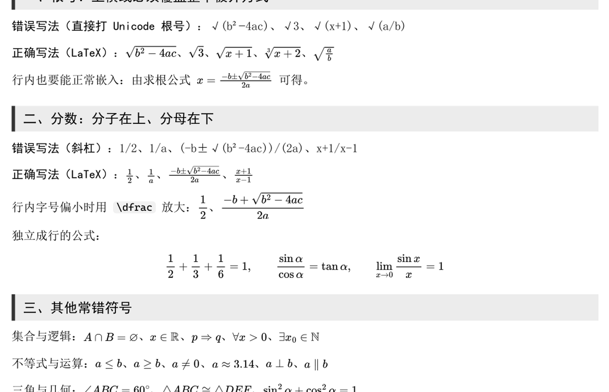
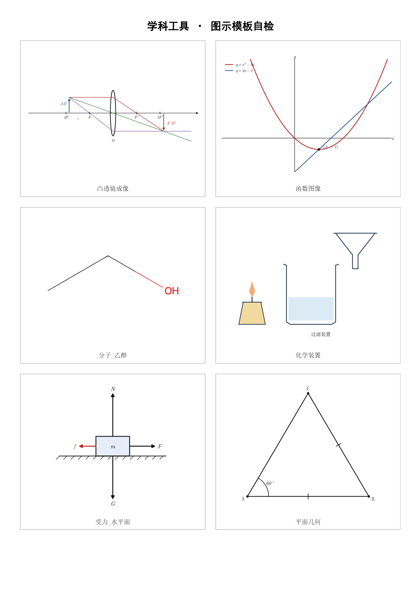
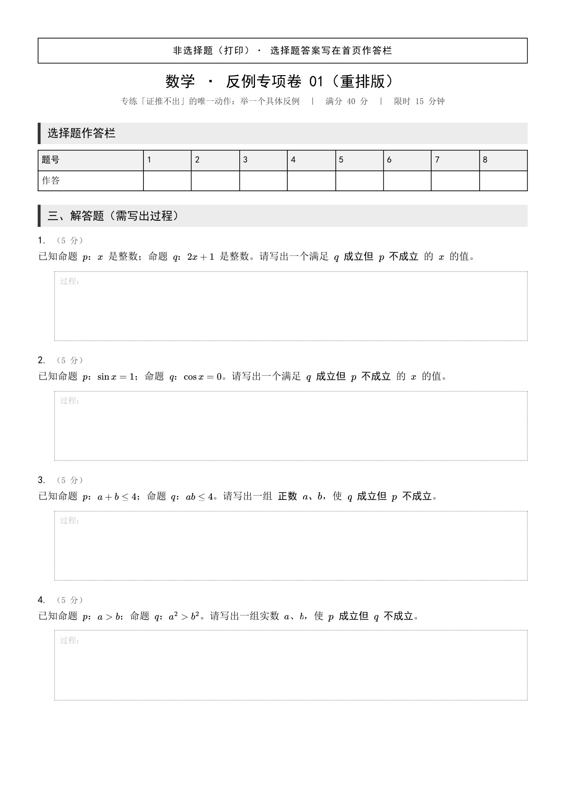

# dsh-subjkit

**大肥鱼自己写的，自用。** 起因很简单：出的卷子里根号横线盖不住被开方式、分数老写成 `1/2`、受力图得一张张手画——索性写成一个工具，自己反复用。没打算做成产品，能用、够用就行；放上来主要是换机器时好 clone。你要顺手就拿去，出问题自己改，我这边只管我这台 Windows。

> 给 DeepSeek Harness（DSH）各学科会话用的**排版 + 图示**工具包。
> 把数学公式排成矢量图，把物理/化学/生物/语文的图直接画出来，最后输出可打印的 PDF。



[下载公式样张 PDF](docs/formula-demo.pdf)　｜　[下载图示样张 PDF](docs/figure-demo.pdf)　｜　[看完整公式样张](docs/formula-preview.png)

---

## 这是一份 DSH 插件

`dsh-subjkit` 是一个**真正的 DSH 插件包**：`package.json` 里声明了 `dsh.bundle.patch`，入口 `src/index.js` 在 `apply(ctx)` 里往宿主注册工具。它不是「把技能改名叫插件」。

装上之后，会话里多出 3 个工具：

| 工具 | 作用 | 主要参数 |
|---|---|---|
| `subject_pdf` | Markdown → 打印用 PDF；公式转矢量路径，可拆奇偶页、出 PNG 预览 | `input`（必填）、`output`、`split`、`preview`、`title`、`subtitle`、`footer` |
| `subject_figure` | 物理/数学/化学/生物/语文图示 → SVG / PNG | `spec`（必填）、`output`、`dpi` |
| `subject_check` | 找出正文里的裸符号、`1/2`、`x^2`，报「行:列 + 建议写法」 | `input`（必填） |

而且**自带两个技能**（`math-typeset`、`subject-diagram`）：插件启动时一并注册，所以「装插件」和「装技能」是同一件事。工具负责做事，技能负责「什么时候用、公式怎么写、字段怎么填」。

底层还是那个 Python CLI（`subjkit.py`）：插件用 `spawn` 调它，结果通过 `--result-json` 临时文件回传（沙箱里拿不到子进程的 stdout）。所以命令行和会话里跑的是**同一套排版引擎**，不存在两份实现。

> 装完如果工具没立刻出现，重启 DSH 即可（用 `plugin_manager` 装通常会当场生效）。安装步骤见 [安装](#安装)。

---

## 它解决什么问题

原来的学科 PDF 有两个很具体的毛病，都是「正文直接写 Unicode 数学字符」造成的：

| 现象 | 原因 | 现在的做法 |
|---|---|---|
| 根号只有 `√`，上横线盖不住后面的字符 | `√(b²-4ac)` 是一个普通字符，后面跟的是普通文字 | `$\sqrt{b^2-4ac}$` 由 MathJax 画出完整根号，横线随内容自动伸长 |
| 分数写成 `1/2`、`1/a`、`(-b±√…)/(2a)` | 用斜杠代替了分数线 | `$\frac{1}{2}$`、`$\frac{-b\pm\sqrt{b^2-4ac}}{2a}$` 上下叠放，中间横线 |
| `∈ ∩ ≤ ≠ ∅ π α ⊥ ∠` 像换了一种字体 | 宋体缺字形，浏览器回退到 Cambria Math / Segoe UI Symbol | 公式统一由 MathJax 排成 **SVG 路径**，不依赖阅读者的字体 |
| 公式放大发虚 | 截图或位图公式 | 全部是矢量，打印任意倍率都清晰 |

同一套工具还覆盖图示：

- **物理**：电路、受力分析、斜面与重力分解、凸透镜成像光路；
- **数学**：函数图像、平面几何、数轴、韦恩图；
- **化学**：常用仪器装置、分子结构式（SMILES）；
- **生物**：植物/动物细胞、过程流程；
- **语文**：田字格 / 米字格练字纸（带拼音）。



### 实际卷子重排

仓库里带了一份真实的数学卷重排样例：[反例专项卷_重排.md](示例/反例专项卷_重排.md)。原来是 `a²`、`1/a`、`A∩B`、`≤` 直接写在 HTML 里；重排后所有式子都是矢量公式，可以直接打印。



[下载重排样张 PDF](docs/paper-demo.pdf)

---

## 快速开始

**环境要求**：Windows 10/11、Python 3.10+、Node.js 18+、Microsoft Edge（用来把 HTML 打成 PDF）。

```powershell
git clone <your-repo-url> dsh-subjkit
cd dsh-subjkit

python -m pip install -r requirements.txt
npm install

python subjkit.py doctor
```

`doctor` 会检查 Python 库、Node、MathJax、Edge 和所有图示模板：

```text
学科工具自检
  Python：3.13.9
  matplotlib  ✔
  numpy       ✔
  pypdf       ✔
  pymupdf     ✔
  rdkit       ✔
  node：C:\Program Files\nodejs\node.EXE
  MathJax：✔
  Edge：C:\Program Files (x86)\Microsoft\Edge\Application\msedge.exe
  ...
结论：✔ 全部可用
```

> `node_modules/` 不进 Git，首次使用执行一次 `npm install` 即可。

---

## 用法

下面按命令行写；在 DSH 会话里对应的是 `subject_pdf` / `subject_figure` / `subject_check` 三个工具，参数名与命令行选项一一对应（`-o` ↔ `output`、`--split` ↔ `split`）。

### 1. 公式文档 / 试卷 → PDF

写一个 Markdown：

```markdown
---
title: 数学 · 函数专项卷 02
subtitle: 满分 60 分　｜　限时 40 分钟
banner: 非选择题（打印）
footer: 第 1 页 / 共 2 页
---

## 一、选择题

1. 函数 $f(x)=\frac{\sqrt{x+1}}{x-2}$ 的定义域是（　　）

## 二、解答题

已知 $x=\frac{-b\pm\sqrt{b^2-4ac}}{2a}$，求证……
```

生成 PDF：

```powershell
# 生成
python subjkit.py pdf 试卷.md -o 试卷.pdf

# 打印件：同时拆奇数页 / 偶数页
python subjkit.py pdf 试卷.md -o 试卷.pdf --split

# 生成后导出首页 PNG，先自己看一遍
python subjkit.py pdf 试卷.md -o 试卷.pdf --preview
```

- 公式在 `$...$`（行内）或 `$$...$$`（独立成行）里；
- 根号写 `\sqrt{...}`，花括号里放**整个**被开方式；
- 分数写 `\frac{分子}{分母}`，行内要清楚时用 `\dfrac`；
- 支持标题、列表、表格、引用、图片、`\newpage` 分页；
- `--split` 会额外生成 `试卷_奇数页.pdf` 和 `试卷_偶数页.pdf`，配合单面打印机。

### 2. 单条公式 → SVG

```powershell
python subjkit.py math "\frac{-b\pm\sqrt{b^2-4ac}}{2a}" -o 求根公式.svg --display
```

生成的 SVG 可直接放进网页、PPT 或 LaTeX 文档。

### 3. 图示

复杂图用 JSON 文件：

```json
{
  "type": "incline",
  "angle": 30,
  "block_label": "$m$",
  "decompose": true,
  "base_label": "$L$"
}
```

```powershell
python subjkit.py fig --spec 斜面.json -o 斜面.svg

# 想先看效果就输出 PNG
python subjkit.py fig --spec 斜面.json -o 斜面.png
```

简单图可以直接写 JSON 字符串：

```powershell
python subjkit.py fig circuit --json '{"nodes":{"A":[0,0],"B":[5,0]},"elements":[{"kind":"battery","from":"A","to":"B"}]}' -o 电路.svg
```

进 PDF 用 `.svg`；发聊天/预览用 `.png`（300 dpi）。

写 spec 时可以先只校验不出图：

```powershell
python subjkit.py fig --spec 斜面.json --dry-run
```

参数写错时给的是中文说明 + 最小可运行示例，不是 Python traceback。`cell` 的 dry-run 还会打印内置标签坐标，方便挑空位加标注。

### 4. 检查裸符号

```powershell
python subjkit.py check 试卷.md
```

输出会标到「行:列」、按 error / warn / info 分级，并给出建议写法：

```text
发现 3 处（error 2 / warn 1 / info 0）（试卷.md）：
  行:列    级别  类型  字符  写法
  12:5    warn  分数  /    $\frac{...}{...}$（\frac{1}{2}）
  13:8    error 符号  √    $\sqrt{…}$
  14:9    warn  幂    ^    $x^{2}$
```

先改到 **0 处**再生成 PDF，能避免 90% 的排版问题。加 `--strict` 有 error/warn 时返回非零退出码（info 不算），方便接 CI。

**数据文档别用默认档**：学情报告里的 `274/450` 是排名分母、`→` 是行文箭头，转成 LaTeX 会把表格撑爆。

```powershell
python subjkit.py check 学情报告.md --profile report   # 比值与箭头降级为 info，error 归零
python subjkit.py check 学情报告.md --profile report --exclude-ratios   # 干脆不看比值
```

**出 PDF 前会自动跑一遍检查**（paper 档），有 error 直接拒绝出图：

```powershell
python subjkit.py pdf 试卷.md --check-only   # 只检查，不出 PDF
python subjkit.py pdf 试卷.md --no-check     # 明确跳过检查
```

> 表格跨页：长表格允许跨页且**表头每页重复**；要让某块整块不跨页，在它前面单独写一行 `<!--keep-->`。

---

## 图示模板

| `type` | 用途 | 关键字段 |
|---|---|---|
| `circuit` | 电路图 | `nodes`、`elements`（battery/resistor/lamp/switch/ammeter/voltmeter/capacitor/rheostat/fuse/motor） |
| `force` | 受力分析 | `body`、`forces`（`angle` 角度、`magnitude` 大小、`label`） |
| `incline` | 斜面 | `angle`、`decompose`、`forces` |
| `optics` | 凸透镜成像 | `focal`、`object_distance`、`object_height` |
| `plot` | 函数图像 | `x`、`y`、`functions`（`expr` 支持 `^`、sin/cos/sqrt/log/abs） |
| `geometry` | 平面几何 | `points`、`segments`、`circles`、`angles`、`right_angles`、`ticks` |
| `numberline` | 数轴 | `min`、`max`、`points`、`intervals` |
| `venn` | 韦恩图 | `sets`、`counts` |
| `apparatus` | 化学装置 | `parts`（beaker/flask/test_tube/funnel/alcohol_lamp/iron_stand/condenser/thermometer…） |
| `molecule` | 分子结构 | `smiles`、`label` |
| `cell` | 细胞 | `kind`（plant/animal）、`notes` |
| `flow` | 流程图 | `steps`、`layout` |
| `grid` | 田字格 | `chars`、`pinyin`、`cols` |

完整字段和示例见 [`skills/subject-diagram/SKILL.md`](skills/subject-diagram/SKILL.md)。

坐标约定：**y 轴向上**，单位任意；电路先布节点坐标，再把元件接在两点之间；受力角度 0° 向右、90° 向上。

---

## 安装

三条路，按需要选一条。

### 1. 装成 DSH 插件（推荐）

前提：本目录和 `node_modules/` 就绪（执行过 `npm install`），且 `python subjkit.py doctor` 全绿。

**推荐的装法**：在 DSH 会话里让助手调用插件管理器，把本目录装进当前 profile：

```text
plugin_manager  action: install_bundle  target: <本仓库根目录的绝对路径>
```

它会替你完成 pnpm 安装和 bundle 选择，并立刻报告是否生效（`application: applied` / `restart-required`）。

**等价的手工做法**（profile 目录 `%USERPROFILE%\.dsh\profiles\<profile名>`）：

1. `package.json` 的 `dependencies` 加
   `"dsh-subjkit": "link:/path/to/dsh-subjkit"`；
2. 同一个 `package.json` 的 `dsh.profile.bundles` 里加 `"dsh-subjkit"`；
3. 在 profile 目录执行 `pnpm install`；
4. **重启 DSH 应用**。

重启后新会话里会出现 `subject_pdf` / `subject_figure` / `subject_check`，技能列表里会出现 `math-typeset`、`subject-diagram`。

卸载：`plugin_manager` 的 `remove_bundle`；手工做法则从 `bundles` 和 `dependencies` 里删掉，`pnpm install`，重启。

### 2. 只装技能（不装插件）

不想要工具、只要「什么时候用、公式怎么写」的提示词时：

```powershell
# 用户级：%USERPROFILE%\.dsh\skills（所有会话可见）
python install.py

# 或只装到当前工作区：<cwd>\.dsh\skills
python install.py --project
```

安装后新开一个 DSH 会话，技能列表里会出现：

- `math-typeset`：公式排版、试卷 PDF、根号/分数修复；
- `subject-diagram`：各科图示模板。

安装脚本会把技能里的 `@@TOOL_DIR@@` 替换成本仓库的绝对路径，所以仓库放在哪里都能用。这条路径**不注册任何工具**，公式和图示仍然要靠下面的命令行。

### 3. 只用命令行

```powershell
python subjkit.py doctor     # 自检
python subjkit.py --help     # 看子命令
```

---

## 目录结构

```text
dsh-subjkit/
├─ src/                      # DSH 插件入口（Node）
│  ├─ index.js               # apply(ctx)：注册工具 + 技能
│  ├─ paths.js               # 包根目录、CLI 入口、Python 解释器
│  ├─ run.js                 # spawn CLI，用 --result-json 取结果
│  ├─ skills.js              # 把 skills/*/SKILL.md 注册成 DSH 技能
│  └─ tools/                 # 一个工具一个文件：spec + execute
│     ├─ pdf.js              #   subject_pdf
│     ├─ figure.js           #   subject_figure
│     └─ check.js            #   subject_check
├─ dsh.plugin.json           # 插件元信息（入口名 + inject）
├─ cordis.patch.yml          # bundle patch：insert dsh-subjkit
├─ locale/                   # 插件管理器的标题/说明（zh / en）
├─ icon.svg                  # 插件图标
├─ subjkit.py                # 命令行入口
├─ subjkit/
│  ├─ cli.py                 # 子命令：pdf / math / fig / check / doctor
│  ├─ md2html.py             # Markdown → 打印 HTML（公式占位）
│  ├─ doc.py                 # MathJax + Edge → PDF，拆奇偶页，导出预览
│  ├─ check.py               # 裸符号/斜杠分数/幂写法检查
│  └─ diagrams/              # 物理、数学、化学、生物、语文图示
├─ assets/
│  ├─ base.css               # A4 打印样式、试卷块、MathJax 对齐
│  └─ render_math.mjs        # MathJax → 矢量 SVG
├─ skills/                   # 自带的两个技能（插件会注册它们）
├─ tests/
│  ├─ test_all.py            # Python 侧 4 段回归
│  └─ plugin_smoke.mjs       # 插件侧：schema 审计 + mock apply + 真跑三个工具
├─ 示例/                      # 公式对照样张
├─ docs/                     # README 预览图
├─ install.py                # 只装技能（不装插件）的轻量路径
├─ requirements.txt          # Python 依赖
└─ package.json              # 插件清单 + MathJax 依赖
```

验证：

```powershell
node tests/plugin_smoke.mjs   # 插件：schema 一致、注册、真跑三个工具
python tests/test_all.py      # 引擎：13 个图示 + 检查器 + 两份真实样张
```

两个都不需要启动 DSH。

---

## 设计说明

**为什么不用 LaTeX 发行版？**
安装 TeX Live 要几个 GB，还要处理中文字体。这里用 Node 端的 MathJax 生成 SVG，浏览器/Edge 负责分页打印，依赖小、离线可用，中文字体直接用系统宋体/黑体。

**为什么公式是 SVG？**
MathJax 的 SVG 输出把每个字形转成 `<path>`，并自带 `<defs>`。PDF 里不引用任何字体文件，换电脑、换阅读器都不会变样。

**为什么图示用 matplotlib？**
坐标、箭头、文字标注都能精确控制，`svg.fonttype='path'` 把文字也转成路径，避免中文字体缺失。分子结构用 RDKit 输出。

**PDF 分页与打印**
`@page` 固定 A4 和页边距；`--split` 用 pypdf 按页码拆成奇数页件/偶数页件，配合只能单面打印的打印机。

**为什么插件用 `--result-json` 而不是 stdout？**
DSH 沙箱里子进程的 stdio 管道可能不可用（`spawn` 用默认 `stdio: 'pipe'` 会 EPERM）。所以插件用 `stdio: 'ignore'` 起进程，Python 把结果**和失败原因**一起写进临时目录的 JSON 文件，Node 读完就删。好处是成功和失败走同一条通道，不会出现「退出码非零但什么都不知道」。

**为什么工具和技能放在一个包里？**
工具解决「能不能做」，技能解决「什么时候做、字段怎么填」。拆成两个包，用户很容易只装一半，然后工具在、说明不在。合成一个包后，装插件即同时得到工具和文档。

**为什么插件不重写排版逻辑？**
排版规则（根号要包住被开方式、分数要 `\frac`）只在 Python 里实现一次。插件是薄适配层——参数映射、路径解析、结果格式化——这样命令行、脚本、会话三处的行为不会分叉。

**为什么 `output.schema` 写成「属性上的 `required: true`」？**
宿主的 `defineTool` 用一套 value schema DSL 编译工具返回值，**不是标准 JSON Schema**：对象级 `required: ["text"]` 会被直接拒绝（`schema.required is not supported by the value schema DSL`），而 `apply()` 的异常又被吞掉，表现就是「插件装上了、没报错、工具不出现」。所以必填一律写在属性上；`tests/plugin_smoke.mjs` 里有一条断言守着这个约定，防止以后改回去。

---

## 常见问题

| 问题 | 处理 |
|---|---|
| 装了插件但会话里没有 `subject_pdf` | 先看 `%TEMP%\dsh-subjkit-apply.log`：`loaded: N registrations` = 插件加载成功，重启 DSH 让会话重新组装工具；`FAILED: ...` = `apply()` 抛了异常（被吞掉以保证 DSH 能启动），按错误原文改 |
| 插件管理器说 `applied` 但工具还是不出来 | `applied` 只代表 bundle 装好、行已挂载；插件自己的 `apply()` 是否成功，以上面那份日志为准 |
| 工具报「找不到 Python 解释器」 | 装 Python 3.10+，或把环境变量 `SUBJKIT_PYTHON` 指向 `python.exe` 的完整路径 |
| `MathJax 未安装` | 在仓库根目录执行 `npm install` |
| `找不到 Edge` | 装 Microsoft Edge；或用 `--keep-html` 先生成 HTML 自己打印 |
| 插件加载失败但 DSH 照常启动 | 这是设计：`apply()` 的异常不会让应用起不来。设 `SUBJKIT_DEBUG=1` 后重载插件，错误会真的抛出来，栈里能看到具体原因 |
| PDF 里出现红色「公式错误」 | TeX 写错，终端会列出原文；检查花括号和反斜杠 |
| 根号仍然很短 | 被开方式没全放进 `\sqrt{...}` |
| 分数还是斜杠 | 正文里还在写 `1/2`；改成 `$\frac{1}{2}$` |
| 中文变方框 | Windows 需有 SimSun / SimHei；可在 `assets/base.css` 改字体栈 |
| 图示箭头被裁 | 调大 `size` 或拉开坐标；检查 `magnitude` 是否相差太大 |

---

## 已知限制

- 目前针对 **Windows + Edge** 调通；其他系统需要改 `subjkit/doc.py` 里的 Edge 路径。
- 电路是直线布线，复杂拓扑需要自己摆节点坐标。
- 化学只做常用仪器和 SMILES 结构式，不做反应机理动画。
- 不替代 Word：需要 `.docx` 请用 DSH 的 `office-docx` 技能。

---

## 仓库

已发布：<https://github.com/LoveElysiaFH/dsh-subjkit>

```powershell
git clone https://github.com/LoveElysiaFH/dsh-subjkit.git
cd dsh-subjkit
npm install
python -m pip install -r requirements.txt
python subjkit.py doctor
```

然后按 [安装](#安装) 里的任一条路装（插件 / 只装技能 / 纯命令行）。

目录名 `dsh-subjkit` 符合 GitHub 上 DSH 插件的 `dsh-*` 命名习惯，仓库就是「一个插件一个文件夹」。`node_modules/`、`示例/输出/`、`__pycache__/` 在 `.gitignore` 里；`docs/` 的预览图和示例源码会一起提交。

想发到 npm 时：`private: true` 要改成 `false`，`files` 已经列好（`src` / `subjkit` / `assets` / `skills` / `locale` / `icon.svg` / 清单文件）。

---

## License

MIT，见 [LICENSE](LICENSE)。
